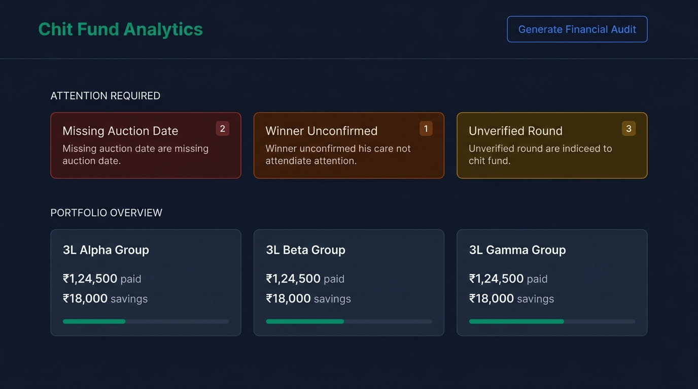
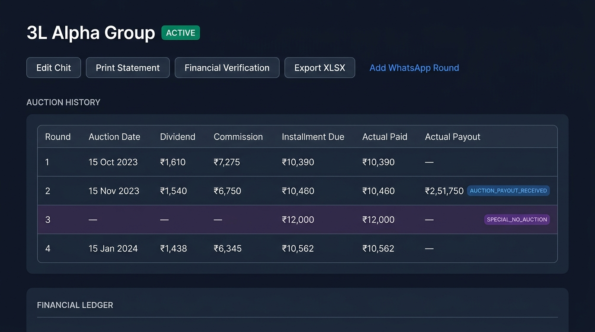
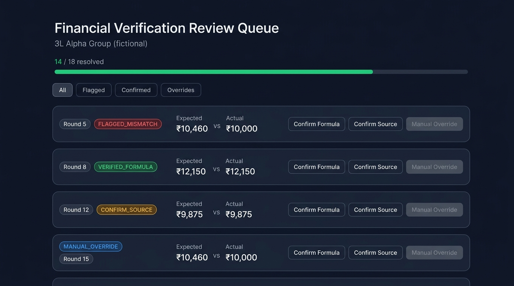

# Chit Fund Analytics

An authenticated personal chit-fund tracker for recording auction rounds, preserving source messages, separating expected calculations from actual cash flows, reviewing discrepancies, and exporting statements. The current implementation is a portfolio project with a live authenticated deployment; it is **not production-ready financial software**.

[](https://chitfund-analytics.vercel.app/)
[](https://github.com/Nithish-kumar-git/chitfund-analytics/actions/workflows/ci.yml)
[](https://nextjs.org/)
[](https://supabase.com/)

- Live app: <https://chitfund-analytics.vercel.app/> (redirects unauthenticated visitors to `/login`)
- Source: <https://github.com/Nithish-kumar-git/chitfund-analytics>
- Maintenance handoff: [docs/CHIT_FUND_ANALYTICS_HANDOFF.md](docs/CHIT_FUND_ANALYTICS_HANDOFF.md)

Screenshots use fictional illustrative data.

| Dashboard | Round detail | Verification |
| --- | --- | --- |
|  |  |  |

## Implemented capabilities

- Supabase Auth and row-level-security policies for owner-scoped records.
- Chit configuration, auction-round records, source-message ingestion and manual classification of unknown events.
- Calculation paths for normal rounds, `SPECIAL_NO_AUCTION`, final rounds and unknown events.
- Verification states: `VERIFIED_FORMULA`, `CONFIRM_SOURCE`, `MANUAL_OVERRIDE`, `FLAGGED_MISMATCH` and the legacy/default state used before review.
- Append-oriented ledger reads, explicit installment and payout recording, manual correction entries, and client-generated idempotency keys for supported forms.
- Completion and verification gates before final ROI is displayed; active chits show actual cash-flow summaries instead.
- Printable statements, XLSX exports and a Markdown audit export.

## Financial model

For a normal auction round, the implemented expected-value calculation is:

```text
net_thallu        = thallu - commission
member_thallu     = net_thallu / member_count
expected_payment  = base_installment - member_thallu
```

Expected values are not automatically proof that money changed hands. Ledger entries represent recorded cash flow. Auction dates and payment dates are separate fields. Installment savings reduce outflow relative to the base installment; they are not profit. Final ROI remains blocked for incomplete, unverified or mismatched data.

See [docs/financial-model-spec.md](docs/financial-model-spec.md), [docs/roi-engine-audit.md](docs/roi-engine-audit.md) and [docs/ARCHITECTURE.md](docs/ARCHITECTURE.md).

## Known integrity and concurrency limitations

These are current blockers, not proposed fixes or completed repairs:

1. Confirming an imported message can turn a parsed `stated_payment` into an `INSTALLMENT_PAID` ledger entry. A stated or due amount is not necessarily evidence that an installment was paid.
2. The current confirmation paths assign the confirmation time to `auction_date` and generated ledger `transaction_date` values. Historical event and payment dates therefore require explicit review and correction.
3. Confirmed ingestion performs multiple Supabase calls sequentially. Auction, ledger and source-message writes are not wrapped in one database transaction, so a mid-sequence failure can leave partial records.
4. Correction creation uses a read-then-insert check. The schema has no unique constraint ensuring that only one correction references an original entry, so concurrent corrections can both succeed.
5. Whole-chit cash-flow verification uses an optimistic `updated_at` check, but per-round formula/source confirmation is not uniformly conditional on the previously reviewed state; zero-row and concurrent-update outcomes are not consistently distinguished.
6. The database does not fully enforce the documented append-only and cross-record invariants. In particular, it does not prohibit updates/deletes to ledger rows, enforce a single correction per original, require correction type/reference pairing, or prove that related profile/chit/event identifiers belong to the same owner.

Until these are repaired and verified against an isolated PostgreSQL/Supabase environment, treat imports, corrections, verification and ROI outputs as review-assisted records rather than an authoritative accounting ledger.

## Architecture

```text
Browser
  -> Next.js 16 server actions and route handlers
  -> Supabase Auth
  -> PostgreSQL tables protected by RLS

Source messages -> parsed proposal -> human confirmation
                -> auction events (expected state)
                -> ledger entries (recorded actual cash flow)
                -> verification gates -> analytics / exports
```

Stack: Next.js 16, React 19, TypeScript 5, Tailwind CSS 4, Supabase Auth/PostgreSQL, Big.js, Vitest and Vercel.

## Local setup

Requires Node.js 20+ and npm. From the repository root:

```powershell
npm ci
Copy-Item .env.local.example .env.local
npm run dev
```

Set only these names in `.env.local`; keep their values private:

| Variable | Purpose |
| --- | --- |
| `NEXT_PUBLIC_SUPABASE_URL` | Supabase project URL |
| `NEXT_PUBLIC_SUPABASE_ANON_KEY` | Public client key used with Auth and RLS |
| `NEXT_PUBLIC_APP_URL` | Application origin used by auth redirects |

The tracked SQL migrations are under `supabase/migrations/`. Do not apply them to a production database as part of local setup or documentation work.

## Focused checks

```sh
npm test
npx tsc --noEmit
npm run lint
npm run build
```

GitHub Actions runs install, tests, type-checking and build for pushes and pull requests to `main`. The previously documented 518-test result belongs to the existing application checkpoint and was **not rerun for this documentation closeout**.

## Deployment status

Vercel reports the production deployment as `READY` from commit `d65a9cd9f02005f66951f42a9f8437cd8ebb65ff`. A read-only HTTP check on 21 October 2026 returned `200` after redirecting to `/login`. This confirms availability and deployment metadata, not correctness of financial records or resolution of the blockers above.

## Project status

Do not freeze this project as production-ready. The documentation can be frozen at this checkpoint, but code work remains for import semantics, historical dates, atomic ingestion, correction concurrency, verification races and stronger database constraints.
